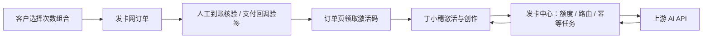

# 额度集市 × 丁小穗

独立商城统一售卡，各项目保留自己的账户和额度。客户在商城购买固定套餐、领取激活码，再到对应项目激活；文案、图片、视频分别计次。

本仓库包含发卡与额度中心、丁小穗业务应用两个完整源码项目。2026-11-07 版本增加独立中心导出、四项目商城入口和一人付三档固定卡兑换。

| 项目 | 源码 | 默认地址 |
| --- | --- | --- |
| 发卡网：商城、管理后台、渠道、订单、卡密和次数账本 | 仓库根目录 | `http://127.0.0.1:3199` |
| 丁小穗：农业品牌与营销创作工作台 | `apps/dingxiaosui/` | `http://127.0.0.1:8845/workbench.html` |

## 当前商城与支付范围

商城保留丁小穗、一二大模型、酒擎、红帆党建四个入口；后三个目前仅为入口，没有可购买套餐。丁小穗支持以下三档固定卡，各自绑定一个独立的一人付收款项目；购买 COUNT 1 权益兑换一张完整卡：

| 套餐 | 价格 | 文案 | 图片 | 视频 |
| --- | --- | --- | --- | --- |
| 尝鲜卡 | 9.90 元 | 10 次 | 15 张 | 2 个 |
| 周卡 | 29.90 元 | 30 次 | 45 张 | 6 个 |
| 月卡 | 99.00 元 | 100 次 | 150 张 | 20 个 |

旺季卡和自由组合保留展示。服务端先持久化兑换意图，明确核销成功后幂等发卡；状态未知查询原记录，重启后可继续交付。权益兑换不冒充逐笔现金到账，原 manual/epay 流程保留。

本地已完成尝鲜卡用户实付、核销、发卡和激活；周/月完成商户只读核对、模拟发卡与激活，尚未实付验收。源码不包含可用商户 Key、客户卡密或数据库；克隆后需要配置自己的服务。详见 [当前验收记录](docs/standalone-payment-connected-20261107.md) 和 [生产部署说明](docs/DEPLOY.md)。

只需要独立商城时，在本仓库安装根依赖后导出到一个不存在的目录：

```sh
node scripts/export-standalone.mjs --dest /absolute/path/to/new-quota-market
```

导出包无需丁小穗源码与 pnpm，可单独 `npm ci`、`npm test`、`npm start`。具体接入方式见 [独立平台说明](docs/standalone-integration.md)。

## 功能

- 按平台管理商品；固定 SKU 或自选文案、图片、视频次数，支持某项为零。
- 批量库存卡，以及付款确认后按订单组合自动签发；重复回调不重复发卡。
- 手机订单页显示激活码；不依赖短信服务。
- QTA 卡激活、同码跨设备恢复原作品空间；文案／图片／视频独立扣次。
- 中转站地址、密钥、模型与平台路由集中管理。支持 OpenAI 兼容协议和 APIMart 适配；其他原生协议需要新增适配器。
- 文案保留知识库与业务提示词；支持文字生图、上传改图、异步视频和作品保存。
- 请求幂等、防止并发超扣、明确失败返还、未知结果保留核对、重启恢复媒体任务。
- 丁小穗原有体验卡与旧账户功能继续保留。

## 快速开始

要求 **Node.js 24+**、Git。丁小穗使用锁定版本 `pnpm 11.25.0`，可通过 `npx` 运行。Windows、macOS、Linux 使用相同 Node 入口。

```sh
git clone https://github.com/foraiyzm-del/dingxiaosui-ai-quota-market.git
cd dingxiaosui-ai-quota-market
npm ci

cd apps/dingxiaosui
npx --yes pnpm@11.25.0 install --frozen-lockfile --ignore-scripts
npm run build
cd ../..

node scripts/start-dingxiaosui.mjs
```

Windows 也可在安装依赖并构建后双击根目录 `启动发卡网与丁小穗.cmd`。

首次启动会生成**本机自己的**配置、加密密钥和数据库，并准备丁小穗平台及组合商品草稿。商品未绑定 API 时不会冒充可用服务；初始化不调用真实模型、不模拟客户付款。

发卡网管理员密码写入私有文件 `local/ACCESS.md`。丁小穗首次管理员设置链接写入 `apps/dingxiaosui/.local-event-runtime/data/admin-setup.txt`。不要把这些文件上传到 GitHub。

只开发发卡网可以直接运行 `npm start`，无需构建丁小穗。

## 配好自己的服务

1. 打开发卡网 `/admin`，在「API 渠道」填写自己的中转站地址、密钥和模型。
2. 在「业务平台」给 `dingxiaosui` 绑定文案、图片、视频所用渠道。只售某类次数时配置相应能力即可。
3. 在「商品套餐」设置 SKU、三类自选次数单价与每类购买次数上限，确认定价后上架。初始化定价仅为可修改示例。
4. 配置收款：个人静态二维码使用人工核账；自动确认使用真实支付商户与签名回调。
5. 客户取得 QTA 卡后，在丁小穗点击「激活」，粘贴卡密即可使用。

一个 QTA 卡对应一个作品空间。同码恢复，换卡切换空间；目前不合并不同卡的作品。三种次数不能互换，历史共享余额另行处理。新接入视频默认 5 秒，旧体验卡保留原 15 秒规格。

QTA 新卡流程的上游 API Key 保存在发卡网后端，丁小穗使用独立平台凭证；旧卡和个人模型仍保留丁小穗自身的服务端渠道配置。调用才发生供应商费用，生成卡密本身不会冻结或购买供应商余额。仓库不附带任何可用的付费账号、API Key 或客户卡密。

## 两个系统如何连接



统一启动脚本自动注入本机连接参数；分开部署时在丁小穗**服务端**配置：

```dotenv
QUOTA_CENTER_URL=https://your-quota-center.example
QUOTA_PLATFORM_KEY=your-dingxiaosui-platform-credential
SHOP_PRODUCT_URL=https://your-shop.example/?service=dingxiaosui-creator
```

平台凭证来自发卡网后台「业务平台 → 接入凭证」，不是管理员密码或上游 API Key。不要使用 `NEXT_PUBLIC_` 前缀或写进浏览器代码。

## 测试

发卡网核心测试不使用真实上游或真实付款：

```sh
npm test
npm run check
```

构建丁小穗后，运行真实双服务、隔离数据库与模拟上游的完整流程验证：

```sh
node scripts/test-dingxiaosui-integration.mjs
```

覆盖自选 `3 文案 + 1 图片 + 1 视频`、模拟签名付款、单次发卡、激活、知识库、分项扣次、图生图、后台视频恢复、作品持久化及跨卡隔离。测试生成目录均已忽略。

丁小穗还有原体验卡、身份、媒体等回归脚本，见 [开发说明](CONTRIBUTING.md)。真实 API 测试应使用开发者自己的账户并明确预算，不会随安装或核心测试自动执行。

## 目录

```text
sidecar/              发卡网 HTTP、渠道、交易、支付、库存与次数逻辑
public/               发卡网商城和后台页面
sdk/                  平台接入的轻量服务端 SDK
scripts/              启动、初始化、检查和跨系统测试
tests/                发卡网隔离测试
docs/                 接口与 APIMart 映射说明
apps/dingxiaosui/      丁小穗完整应用源码、迁移、静态素材与测试
```

## 部署与数据

默认只监听回环地址。手机或外部用户无法使用另一个设备的 `127.0.0.1`；正式部署需要 HTTPS、反向代理、允许域名、两个服务之间可达的地址和公开商品网址。自动付款还需要真实商户及公网回调。仓库公开不等于网站已经部署。

发卡网 `local/` 和丁小穗 `.local-event-runtime/` 分别保存私有配置与业务数据。备份须连同对应加密主密钥、平台凭证一起保留；运行中的 SQLite 使用一致性备份，不要只复制主库或用测试库覆盖线上。迁移是追加式的，包括 `0017_quota_center.sql`。

个人二维码、付款截图及“我已付款”都不自动证明到账。异常生成任务应核对原任务和供应商账单，不能直接退款后再重发。

## 文档与许可

- [发卡中心 API 与 SDK](docs/integration.md)
- [丁小穗接入说明](apps/dingxiaosui/docs/quota-center-integration.md)
- [APIMart 适配](docs/apimart-integration.md)
- [开发贡献](CONTRIBUTING.md) · [安全报告](SECURITY.md)
- [MIT 代码许可](LICENSE) · [第三方声明与素材说明](THIRD_PARTY_NOTICES.md)

项目保留紫丁香／丁小穗演示品牌和示例内容。二次发布时请替换自己的品牌、联系方式和业务内容；代码许可不授予第三方商标或肖像的权利。额外的多镜头短片合成模块需 FFmpeg、ffprobe 和中文字体，不是主 APIMart 视频流程的必需依赖。
