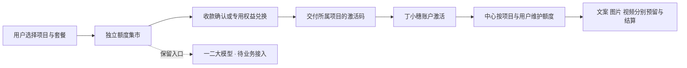

# 独立额度中心与多项目接入

2026-11-07 用户确定：统一商城购买，各项目保留自己的账户；额度按项目隔离。丁小穗是现有接入方；用户随后限定“一二大模型”先保留入口，本轮不接入其业务账户或生成流程。

同日先在原开发副本完成用户确认实付 9.90 元、真实权益核销、发卡和丁小穗激活，再将原 3499 账本、商户配置与项目凭证迁入本机独立商城 3399。本机现已开放尝鲜卡、周卡和月卡的独立支付宝入口，周卡与月卡真实付款尚未验收；按用户最新要求只显示丁小穗、一二大模型、酒擎、红帆党建，后三项仅入口，原营销文案与包装设计示例已移除。本轮迁移未新增付款或核销。最新结果见 [独立商城支付接通验收](standalone-payment-connected-20261107.md)，先前付款证据见 [实付记录](opcpay-live-acceptance-20261107.md)。

## 职责与购买流程



中心管理商品、订单、支付适配、库存、卡密、额度和渠道。业务项目负责登录、业务提示词、生成体验和作品。购买者在商城领取卡密，再到对应项目登录激活；不增加跨项目登录或公共余额。

“相同计费方式”表示采用同一套按能力计次规则。各项目价格、套餐数量分别在后台设置；演示中使用的 9.90 元和 10/15/2 只是示例，不作为一二大模型的正式定价。

## 独立交付

以下是新导出示例，目标目录必须尚不存在；本机已经配置的 `quota-market-standalone` 直接按后文启动，不重新导出覆盖：

```powershell
node scripts/export-standalone.mjs --dest E:\codex\new-quota-center
cd E:\codex\new-quota-center
npm ci
npm test
npm run check
npm start
```

导出只接受不存在的目标目录；使用显式源码清单，不带丁小穗应用、安装依赖、数据库、运行目录、支付或模型密钥。独立目录的 README 和导出 manifest 说明来源及测试范围。Node.js 需要 24+；仅使用根目录 npm 锁文件，不需要 pnpm 或构建丁小穗。

新导出目录的普通 `npm start` 从自己的 `local/` 初始化私有配置与数据库；默认 3199 端口，不自带商户 Key。已有服务使用该端口时，先在此副本 `local/config.json` 中改为未占用端口，不停止其他服务。管理员资料仅在本地 `local/ACCESS.md` 查看。

当前已配置本机实例 `E:\codex\quota-market-standalone` 使用 3399，直接 `npm start` 复用已迁入的私有数据，`localModelMock:true` 保持模拟模型。丁小穗单独在完整仓库运行 `node scripts/start-dingxiaosui-attached.mjs`，使用原应用数据、密钥及快照连接 3399；工作台地址保持 8945，购买入口为 `http://127.0.0.1:3399/?project=dingxiaosui`。旧 3499 中心已停止，迁移标记禁止旧联合脚本再次启动它。源码导出不迁移这些私有状态，也不导出应用启动器。

## 多项目模拟演示

```powershell
node scripts/start-multiproject-demo.mjs
```

默认地址 `http://127.0.0.1:3299/`，数据独立保存在 `local/multiproject-demo/`。启动先检查端口，端口占用即退出。演示内的所有模型响应均为本地模拟，付款仅供模拟核账，无真实付款或模型费用。

- 首页按项目选择套餐；`/?project=dingxiaosui` 和 `/?project=second-project` 可直接打开项目商品。
- 创建订单后，在演示后台按模拟流程确认，再回订单页领取测试卡。
- “去兑换使用”进入本项目接入体验页；激活后显示文案 10、图片 15、视频 2。
- 生成文案只扣文案次数；图片和视频同理。需要确认交付的媒体先保留额度，确认同一结果后只结算一次。
- 测试“一二大模型”是通用模拟接入页，不是其实际应用。丁小穗演示页也不是已有创作工作台；原工作台仍在原副本独立运行。

接入体验页账户关联当前浏览器 Cookie，仅用于演示。它不替代其他项目的持久用户登录。

## 新项目操作

1. 后台「业务平台」创建独立 ID，配置项目名称、公开使用地址和文案／图片／视频模型路由。
2. 「商品套餐」创建属于此项目的商品，配置固定套餐或已有的自由组合定价。价格与三类次数以中心保存的配置为准。
3. 「业务平台 → 接入凭证」获取本项目服务端凭证；仅放入该业务项目的私有配置。
4. 项目增加商城入口 `https://商城域名/?project=项目ID`，登录后提供激活码输入、余额和消费记录。
5. 项目后端从已经验证的登录会话获取稳定用户 ID，调用中心 SDK 激活与使用额度。

```dotenv
QUOTA_CENTER_URL=https://quota.example.com
QUOTA_PLATFORM_KEY=在本机私有配置填写
SHOP_PRODUCT_URL=https://quota.example.com/?project=your-project
```

中心按凭证决定项目；`userId` 由项目后端从会话获得。浏览器不能自行指定用户、渠道、扣次数量或价格。禁止把平台凭证放入前端构建变量。

## 接入代码要点

复用 `sdk/client.mjs`，无需更改中心账本：

```js
const usage = createUsageClient({
  baseUrl: process.env.QUOTA_CENTER_URL,
  apiKey: process.env.QUOTA_PLATFORM_KEY,
});
const userId = session.user.id; // 来自项目已经验证的服务端会话
await usage.redeem({ userId, code: submittedCode, idempotent: true });
const balance = await usage.balance(userId);
const job = await usage.generate({
  userId, requestId: persistedRequest.id, capability: 'text', prompt,
});
```

同一平台、同一用户重复激活同一张卡不会增加额度。相同用户 ID 出现在另一个项目时，是另一份账本。错误项目不能激活卡片或读取任务。

`generate` 已负责预留、上游执行和结算，不要外层重复扣次。图片／视频任务可能经历 `running → ready → succeeded`：持久保存任务 ID；拿到可用结果后，由业务后端调用 `usage.deliver({id,userId,action:'accept'})`。网络超时只查询／重试原请求，不换请求编号重新生成。

已有自己的模型编排时，使用 `reserve({userId,requestId,units,capability}) → commit/cancel`。`units` 来自服务端业务规则；成功提交、明确未交付才取消，结果未知时保留原预留并查原任务。不要混用两种扣次方式。

余额按 `byCapability.text/image/video` 展示。三类数量不可互换，合计 27 不代表任一能力可以使用 27 次。完整接口见 [integration.md](integration.md)。

## 卡片二维码与旧配置

原 `dingxiaosuiOrigin` 仅用于丁小穗卡片的导出。其他项目不继承该地址：缺少明确地址时 CSV 激活链接为空，二维码导出返回需要配置入口的提示。

目前二维码接口接受管理员显式传入该项目的站点根 `origin`，生成 `/redeem?code=...`。该项目必须实现此路由后才能使用；普通工作台网址不表示已有此接口。没有该路由时使用卡密输入激活和商城中配置的项目公开入口。

## 支付与上线边界

人工核账和易支付仍可用于通用商城。一人付适配支持丁小穗尝鲜卡、周卡和月卡，各自使用只含一档 COUNT 1 套餐的专用收款项目；旧 `nsy` 四套餐项目保留。以下为尝鲜卡实付和账本迁移的历史记录，周卡与月卡仅在本机启用、真实付款尚未验收。原开发副本在 `local/opcpay-live-test/`、3499 商城与 8945 丁小穗服务完成真实核销及 10／15／2 激活，刷新、重复激活、同买家恢复和重启均保持同卡同余额。随后授权迁移将这份本地实付账本及对应私密配置交给独立商城 3399；原 27 张表逐行核对一致，目标原有 2 件商品及套餐保留。2 个买家、1 个已交付意向和 1 个等待权益到账意向原样保留，没有新增付款或核销。不同项目商品仍不能使用丁小穗的权益池据此发卡。

一人付 `access/consume` 不按 SKU 区分池内权益；扩展前需确认每个项目／兑换规则的商户项目、审核套餐、API Key、交付范围和退款路径。用户已确认丁小穗专用项目允许核销后交付自有卡、退款由官方客服人工处理；本次未实际退款。公开接口尚无逐笔现金查单、退款或核销撤销能力，本次实付 9.90 元由用户确认，系统仅记录权益兑换，不伪造现金已付或支付宝流水。不能用本地取消替代退款。

本轮“一二大模型”配置为 `second-project` 启用入口，没有在售商品与购买按钮。日后决定正式接入时，再提供源码／仓库地址并核对现有身份会话和生成入口；其定价不沿用测试套餐作默认承诺。上线还需要域名、HTTPS、私密配置、对应环境的真实支付验收与备份。本次只迁移授权的本地测试数据，没有迁移生产数据库或部署线上。
